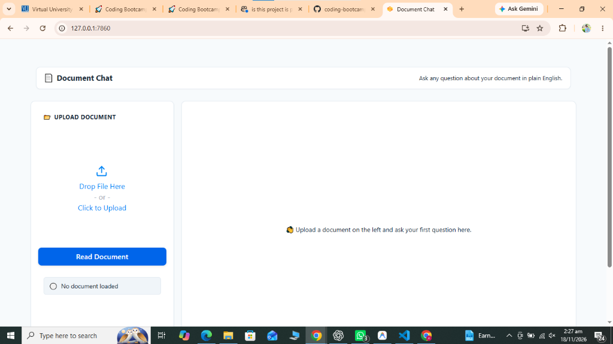
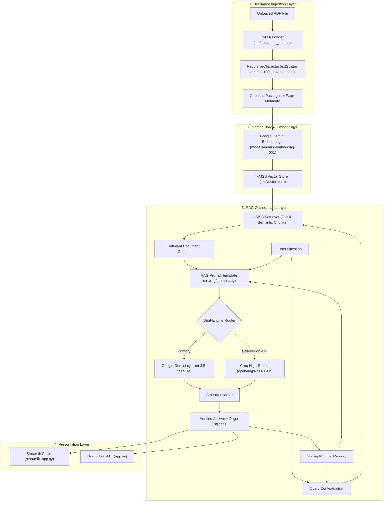

# 📑 Smart Document Reader

[](https://smart-document-reader-rag-8znyeoqp68etgjedfghkku.streamlit.app/)
[](https://www.python.org/downloads/)
[](https://www.langchain.com/)
[](https://streamlit.io/)
[](LICENSE)
[](https://github.com/AmirSaad1417)

> **Turn any document into a smart assistant — ask for summaries, key facts, or detailed explanations.**  
> An enterprise-grade **Retrieval-Augmented Generation (RAG)** platform featuring **Google Gemini Embeddings**, **FAISS vector indexing**, and **Intelligent Dual-Provider Failover (Gemini + Groq)** with verified page-level source citations.

---

## 🌐 Live Application

Access the live, deployed web application here:  
👉 **[https://smart-document-reader-rag-8znyeoqp68etgjedfghkku.streamlit.app/](https://smart-document-reader-rag-8znyeoqp68etgjedfghkku.streamlit.app/)**

---

## 🖼️ Application Interface



---

## 🏛️ System Architecture



---

## ✨ Key Features

* **🛡️ Zero-Downtime Dual-Engine Failover:** Combines **Google Gemini (`gemini-3.5-flash-lite`)** and **Groq (`openai/gpt-oss-120b`)**. If either provider hits a rate limit (429) or token ceiling, the system automatically falls back to the other provider seamlessly.
* **📍 Page-Accurate Citations:** Answers include clickable, collapsible page references (`📍 View Document Sources`) quoting exact excerpts so users can verify every claim.
* **🧠 Contextual Follow-Up Memory:** Intelligently handles multi-turn dialogues, evaluations, and short follow-ups (e.g. *"rate out of 10"*, *"why?"*, *"summarize his projects"*).
* **⚡ Blazing Fast FAISS Indexing:** Millisecond semantic search across hundreds of document pages.
* **🔒 Enterprise Security:** Strict zero-secret-leak design — all API keys and environment files are git-ignored and handled via cloud secret managers.

---

## 📂 Project Structure

```text
smart-document-reader/
│
├── .env.example                 # Environment configuration template
├── .gitignore                   # Version control exclusions (secrets, caches)
├── requirements.txt             # Pinned project dependencies
├── README.md                    # Enterprise architectural documentation
│
├── config/                      # Centralized Configuration
│   ├── __init__.py
│   └── settings.py              # Pydantic BaseSettings & Streamlit secrets loader
│
├── src/                         # Core Application Source Code
│   ├── __init__.py
│   ├── core/                    # Structured logging utilities
│   │   ├── __init__.py
│   │   └── logger.py
│   ├── document_loaders/        # PDF extraction & text chunking
│   │   ├── __init__.py
│   │   └── pdf_loader.py        # PDFProcessor with page-level metadata
│   ├── vectorstore/             # Embeddings & Vector Database
│   │   ├── __init__.py
│   │   └── faiss_store.py       # VectorStoreManager (FAISS + Gemini)
│   ├── rag/                     # RAG orchestration & pipeline
│   │   ├── __init__.py
│   │   ├── prompts.py           # Evaluative and analytical prompt templates
│   │   ├── memory.py            # Sliding window conversational memory
│   │   └── chain.py             # Dual-engine failover RAG service
│   └── ui/                      # Gradio Presentation Layer
│       ├── __init__.py
│       └── gradio_app.py        # Minimalist, high-readability Gradio interface
│
├── assets/                      # Application screenshots and diagrams
│   └── app_preview.png
│
├── notebooks/                   # Interactive Exploration
│   └── rag_chatbot.ipynb        # Clean end-to-end Jupyter Notebook
│
├── tests/                       # Automated test suite
│   ├── __init__.py
│   └── test_rag.py              # Unit tests for settings, memory, and chunking
│
├── streamlit_app.py             # Production Streamlit Cloud Application
├── app.py                       # Local Gradio Application
└── main.py                      # Headless CLI entrypoint
```

---

## 🚀 Quickstart Guide

### 1. Clone the Repository
```bash
git clone https://github.com/AmirSaad1417/smart-document-reader.git
cd smart-document-reader
```

### 2. Install Dependencies
```bash
pip install -r requirements.txt
```

### 3. Configure Secrets (.env)
Create a `.env` file in the project root:
```env
# API Keys
GEMINI_API_KEY=your_gemini_api_key_here
GROQ_API_KEY=your_groq_api_key_here

# Model Configuration
EMBEDDING_MODEL=models/gemini-embedding-001
GEMINI_LLM_MODEL=gemini-3.5-flash-lite
GROQ_LLM_MODEL=openai/gpt-oss-120b
```

### 4. Run Locally

#### Option A: Streamlit UI
```bash
streamlit run streamlit_app.py
```

#### Option B: Gradio UI
```bash
python app.py
```

#### Option C: Headless CLI
```bash
python main.py path/to/document.pdf "What are the main findings?"
```

---

## 🌐 Deploy to Streamlit Community Cloud (100% Free)

1. Fork or push this repository to your GitHub account.
2. Go to [share.streamlit.io](https://share.streamlit.io) and click **"New app"**.
3. Select:
   * **Repository:** `AmirSaad1417/smart-document-reader`
   * **Branch:** `main`
   * **Main file path:** `streamlit_app.py`
4. Expand **Advanced settings...** ➔ **Secrets** and paste:
   ```toml
   GEMINI_API_KEY = "your_gemini_api_key"
   GROQ_API_KEY = "your_groq_api_key"
   ```
5. Click **Deploy!** Your app is live with public access in under 60 seconds.

---

## 🧪 Automated Testing
Run the unit test suite to verify all pipeline components:
```bash
python -m unittest tests/test_rag.py
```

---

## 🛡️ Security & Privacy
* **Zero Secret Leakage:** `.env` and `.env.*` files are strictly excluded from version control via `.gitignore`.
* **In-Memory Processing:** Uploaded files and temporary vector indexes are managed in-memory or in transient temporary directories.
* **Client Isolation:** Each user session maintains its own isolated conversation memory.

---

## 📄 License
Distributed under the **MIT License**. See `LICENSE` for more information.

---

**Developed with ❤️ by [Amir Saad](https://github.com/AmirSaad1417)**
